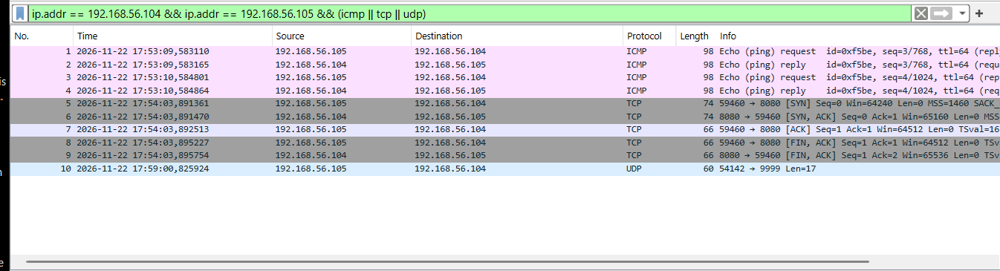
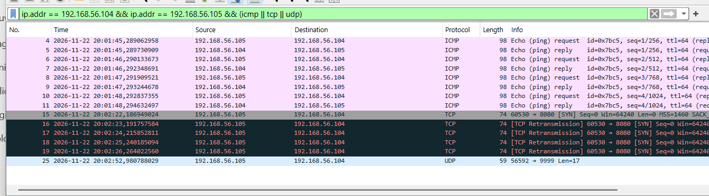
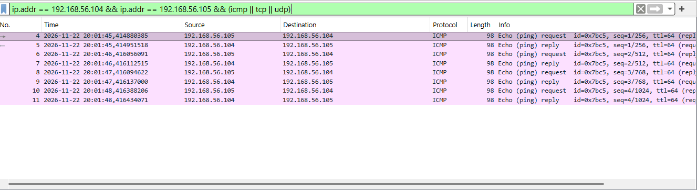

# eBPF/XDP IPv4 ICMP Filter

## Overview

This repository implements a simple network packet filter using **eBPF** and **XDP (eXpress Data Path)** in C.

The program is attached to a Linux network interface and inspects incoming Ethernet frames. It allows IPv4 packets carrying ICMP traffic while dropping all other IPv4 protocols, including TCP and UDP.
## Filtering Logic

The program first examines the Ethernet header to identify the packet's EtherType. If the packet contains IPv4 traffic, it inspects the IPv4 protocol field to determine the appropriate action.

| Traffic | XDP Action | Behavior |
|---|---|---|
| IPv4 ICMP | `XDP_PASS` | Allow |
| IPv4 TCP | `XDP_DROP` | Drop|
| IPv4 UDP | `XDP_DROP` | Drop |


## Experimental Environment

The XDP filter was tested using two Kali Linux virtual machines running in VirtualBox and connected through a Host-Only network.

- **Sender VM:** (192.168.56.105/24)Generates ICMP, TCP, and UDP traffic to test the filter's packet-handling behavior.
- **Receiver VM :** (192.168.56.104/24) Hosts the XDP-based packet filter, which inspects incoming packets and make the decision.
## Installation and Dependencies

Install the required packages on Kali Linux:

```bash
sudo apt update
sudo apt install clang llvm libbpf-dev libelf-dev zlib1g-dev
```

## Compilation

Compile the C source file into an eBPF object file:

```bash
clang -O2 -g -target bpf -c xdp_filter.c -o xdp_filter.o
```

## Deployment

Attach the program to the desired network interface on the receiver VM:

```bash
sudo ip link set dev <interface> xdpgeneric obj xdp_filter.o sec xdp
```

Replace `<interface>` with the name of the receiver's network interface.


## Testing Methodology

Traffic was generated from the sender VM towards the receiver VM to evaluate the filtering behavior.

### 1. ICMP Test

ICMP traffic was generated using:

```bash
ping -c 4 <receiver_IP>
```


### 2. TCP Test

A TCP listener was started on the receiver:

```bash
nc -lvnp 8080
```

The sender attempted to establish a connection:

```bash
nc -nvz -w 5 <receiver_IP> 8080
```


### 3. UDP Test

A UDP listener was started on the receiver:

```bash
nc -ulvnp 9999
```

The sender transmitted a UDP datagram:

```bash
echo "UDP test message" | nc -u -w 2 <receiver_IP> 9999
```


##  Results

### Experiment 1: Without XDP
ICMP, TCP, and UDP traffic was generated from the sender VM and captured on the receiver VM using Wireshark.

The capture shows that all three types of traffic all passed. 

### Experiment 2: With XDP attached 
The same types of traffic were generated again, this time with the XDP filter attached to the receiver's network interface.

The sender-side Wireshark capture shows the generated packets.


The receiver-side capture illustrates that TCP and UDP packets were dropped by the XDP filter and only the ICMP traffic actually passed.

